<picture>
  <source media="(prefers-color-scheme: dark)" srcset="assets/banner-dark.svg">
  
</picture>

 

Transformo rotinas manuais de escritórios e operações periciais — conferir publicações, separar e-mails, montar planilhas e documentos — em processos automáticos que entregam o resultado pronto para conferência humana.

Estudante de Engenharia da Computação, com passagem por suporte técnico e engenharia de dados (pipelines ETL com Airflow). Hoje atuo com automação e IA aplicada ao setor jurídico.

## O que entrego

- **Implantação de IA em escritórios** — configuração do Claude, skills sob medida para a rotina da equipe e treinamento.
- **Monitoramento automático** — robôs que acompanham publicações, intimações e caixas de e-mail e avisam o que exige ação.
- **Painéis de gestão** — coleta diária de dados da carteira de processos, com indicadores para controladoria, jurídico e gerência.
- **Workshops** — capacitação prática de equipes no uso seguro de IA.

## Projetos

**[NomiBot](https://github.com/alesncar/NomiBot)** · Monitor de nomeações periciais 
Nomeações chegavam por vários canais, repetidas e em formatos diferentes, e a triagem manual corria o risco de perder prazos curtos. O sistema coleta as fontes todos os dias, elimina duplicidades, classifica com regras e modelo de linguagem (dados pessoais mascarados), apura prazos e envia um boletim diário.

**[Apuama](https://github.com/alesncar/Apuama)** · Triagem de e-mails corporativos 
Convocações com prazo fatal chegavam misturadas a cobranças e marketing na mesma caixa. Um modelo de linguagem separa cada mensagem por categoria e sinaliza as urgentes, sem apagar nada e sem enviar conteúdo sigiloso para fora do servidor. Em produção desde julho de 2026, a cada 15 minutos.

**[Sumaúma](https://github.com/alesncar/Sumauma)** · Painel de controladoria 
Centenas de processos eram acompanhados tarefa a tarefa, sem visão da carteira. Uma rotina diária coleta os dados em modo somente leitura, confere a consistência e publica um painel único de prioridades, entregas e honorários. Coleta em produção; painel em validação com a equipe.

**[Igapó](https://github.com/alesncar/Igapo)** · Skills de IA para perícia judicial 
Cada etapa da perícia — análise da nomeação, honorários, petições, laudos e arquivo — virou uma skill que entrega o documento pronto, no padrão da empresa, para conferência humana.

Os quatro repositórios são vitrines: o código de produção é privado. Outros trabalhos: [ocr_pdf_automation](https://github.com/alesncar/ocr_pdf_automation) (OCR de PDF e extração de campos com LLM).

## Princípios

| | |
|---|---|
| **Somente leitura** | A automação consulta os sistemas de origem; não altera cadastros nem pratica atos processuais. |
| **Sigilo primeiro** | Dados pessoais são mascarados antes da IA; conteúdo sigiloso não sai do ambiente do cliente. |
| **Nada se perde** | Na dúvida, o item vai para conferência; dado divergente bloqueia a publicação em vez de virar número errado. |
| **A pessoa decide** | A IA prepara; a decisão, a assinatura e o protocolo são sempre humanos. |

## Tecnologias

Python · FastAPI · Flask · PostgreSQL · MySQL · SQLite · Elasticsearch · Docker · Azure · Apache Airflow · n8n · Claude (skills e agentes) · Azure OpenAI · Gemini · Mistral

## Contato

<b>English summary</b>

 

I turn manual routines in law firms and judicial expert offices — monitoring court publications, sorting e-mail, building spreadsheets and documents — into automated workflows that deliver results ready for human review. Projects above: court-appointment monitoring (NomiBot), LLM-based e-mail triage (Apuama), a case-portfolio dashboard (Sumaúma) and a suite of AI skills for expert reports (Igapó). Principles: read-only access to source systems, privacy first, nothing gets lost, and people make the final decision.

