  

  

### `> whoami`

Sou de Manaus e estudo Engenharia da Computação. Meu trabalho é olhar uma rotina que toma horas da equipe — conferir publicação por publicação, separar e-mail, montar planilha à mão — e transformar isso em algo que roda sozinho e entrega pronto para alguém conferir.

Já passei por suporte técnico (onde aprendi a ouvir o usuário), por engenharia de dados (pipelines ETL com Airflow) e hoje vivo de automação e IA aplicada.

### `> loadout`

  

- **IA:** Claude (skills e agentes) · Azure OpenAI · Gemini · Mistral · engenharia de prompt
- **Automação:** Apache Airflow · n8n · robôs agendados em servidor

### `> mapa de projetos`

| | Projeto | O que faz |
|---|---|---|
| `A` | [**NomiBot**](https://github.com/alesncar/NomiBot) | Lê as publicações judiciais todo dia, acha as nomeações periciais e manda o boletim por e-mail. |
| `A` | [**Apuama**](https://github.com/alesncar/Apuama) | Separa caixas de e-mail por categoria com um modelo de linguagem, a cada 15 minutos. |
| `A` | [**Sumaúma**](https://github.com/alesncar/Sumauma) | Painel de controladoria: coleta diária da carteira de processos, prioridades, entregas e honorários. |
| `B` | [**Igapó**](https://github.com/alesncar/Igapo) | Ecossistema de skills de IA que cobre a rotina de uma perícia, da nomeação ao laudo. |
| `B` | [**ocr_pdf_automation**](https://github.com/alesncar/ocr_pdf_automation) | OCR de PDF com Azure e extração de campos em JSON com LLM. |

> NomiBot, Apuama, Sumaúma e Igapó são vitrines: o código de produção fica em repositório privado.

### `> fora do código`

Conduzo workshops de IA para equipes e implanto o Claude em escritórios, com skills sob medida para a rotina de cada um.

### `> contato`

